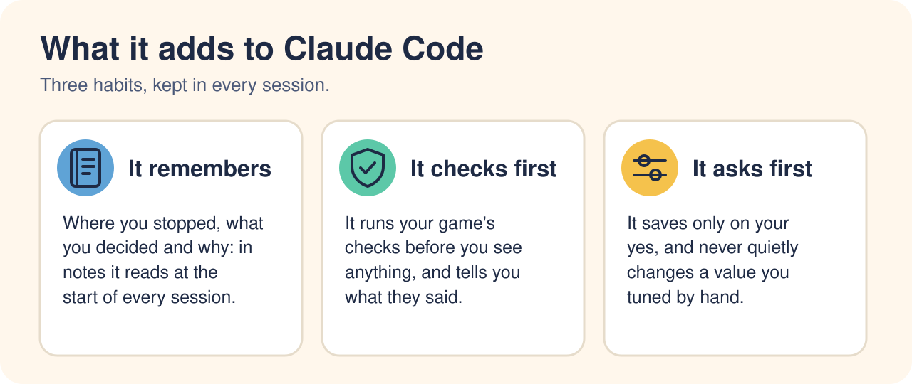
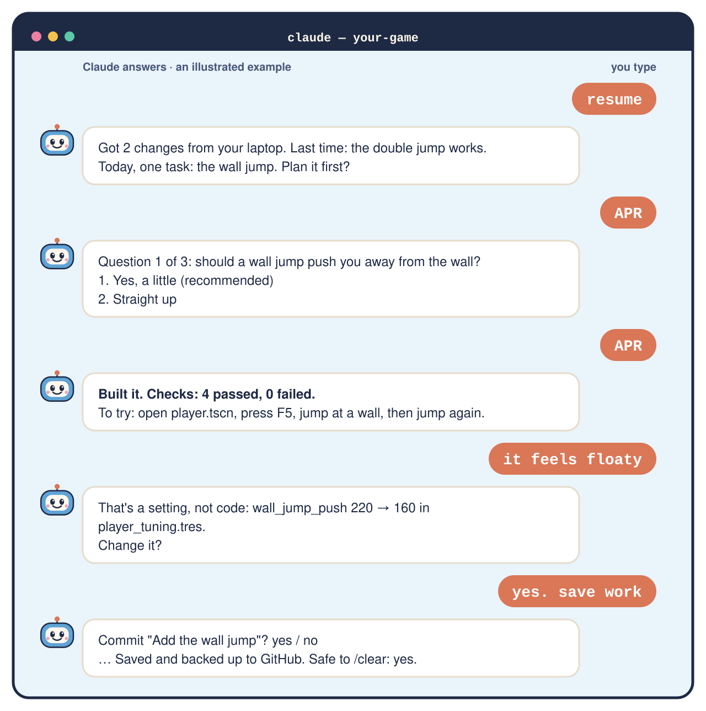
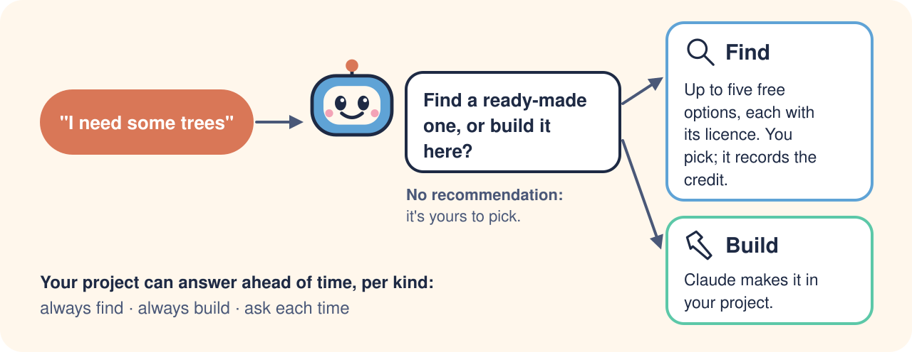

<div align="center">

<picture>
  <source media="(prefers-color-scheme: dark)" srcset="assets/readme/hero-dark.svg">
  
</picture>

[](https://github.com/dawnmaster1337/godot-noob-accelerator/releases)
[](https://godotengine.org)
[](https://code.claude.com/docs)
[](LICENSE)

**Claude Code forgets between sessions, calls untested work done, and can undo what you tuned by
hand. This kit gives it notes to read first, checks to run before you see anything, and a habit
of asking before it saves.**

<a href="docs/beginners-guide.md"></a>
<a href="#install"></a>

</div>

## What it is

A free add-on (a *plugin*) for **Claude Code** that helps it build your **Godot 4** game
carefully, over weeks. You say what you want in plain words. Claude writes the code, keeps the
notes and runs the checks. You play it and decide. **No coding experience needed.**

<picture>
  <source media="(prefers-color-scheme: dark)" srcset="assets/readme/promises-dark.svg">
  
</picture>

- **It remembers.** Where you stopped, what you decided and why are kept in notes it reads at the
  start of every session, on any computer.
- **It checks first.** It runs your game's checks before you see anything, and tells you what
  they said.
- **It asks first.** It saves only on your yes, and treats a value you tuned by hand as yours.

## What a session looks like

You type a few words. Claude asks one question at a time, each with a suggestion. Type **APR**
("as per recommendation") to take it.

<p align="center">
<picture>
  <source media="(prefers-color-scheme: dark)" srcset="assets/readme/session-dark.svg">
  
</picture>
<br><sub>A drawing of a typical session, not a recording.</sub>
</p>

**This part is real.** Below is a game whose script looks for a node that isn't there. Godot runs
it and reports success (exit code 0). The kit's check reads what Godot printed, and fails:

```console
$ godot --headless --path . --quit-after 60 > /dev/null 2>&1; echo "exit code: $?"
exit code: 0

$ tools/dev.sh check
FAIL tests/smoke_check.tscn (exit 0, Godot printed errors)
while playing the main scene:
ERROR: Node not found: "HealthBar" (relative to "/root/Main").
```

## Plain Claude Code, or with the kit?

| | Plain Claude Code | With the kit |
|---|---|---|
| **A new session** | Remembers little; you explain it all again | Reads its notes: where you stopped, what's next |
| **"It works!"** | Often untested; you find the bugs | The checks ran first, and it tells you what they said |
| **Your hand-tuned jump** | Can quietly change it back | Treated as yours; it asks before touching it |
| **A big new feature** | Starts coding straight away | A few questions, a short plan, then your OK |
| **Two computers** | One can redo what the other already did | It fetches first and asks before pulling |

<details>
<summary><b>Where these come from: six things that went wrong in our own games</b></summary>
<br>

| What went wrong | What the kit does now |
|---|---|
| Claude kept handing over work that didn't run | It runs the checks before you see anything, and quotes them |
| Its notes grew to 875 lines, all read every session | Notes have size limits, and a check warns |
| Weeks later, it did something we'd decided against | Decisions are written down and read first |
| Three games kept their notes three different ways | One layout in every game (one went from 29 problems to 0) |
| It quietly undid a jump we'd tuned by hand | Your changes are yours: it asks before touching them |
| One computer redid work another had already pushed | Each session checks your other computers first |

These help a lot. They don't make Claude perfect: you still play and decide.

</details>

## Is it for you?

| | |
|---|---|
| ✅ **Never written code** | Made for you. Start with the [beginner's guide](docs/beginners-guide.md): about an hour, from nothing installed to something moving on screen |
| ✅ **Made a few things** | Also for you. Five minutes to [install](#install), then say **resume** each session |
| 🟡 **A game jam or a weekend try** | Plain Claude Code is enough. The kit pays off on a game you'll work on for weeks |
| 🟡 **A seasoned developer** | It may feel slow. Take the parts you like: [every rule can be changed](docs/customising.md) or turned off |

## How it goes

One small task per session, saved, then a fresh start.

<picture>
  <source media="(prefers-color-scheme: dark)" srcset="assets/readme/loop-dark.svg">
  
</picture>

| You say | Claude… |
|---|---|
| **resume** | picks up where you stopped, on any computer |
| **I want to add…** | asks a few questions, then makes a plan for your OK |
| **let me play it** | tells you what to open and what to try |
| **feels too slow** *(any feeling)* | changes a setting you can see, not the code |
| **save work** | saves, but only when you say yes |
| **wrap up** | writes down where you stopped, for next time |

Not sure what Claude means? Say **"explain like I'm new"**.

## Find or build: your call

<picture>
  <source media="(prefers-color-scheme: dark)" srcset="assets/readme/find-or-build-dark.svg">
  
</picture>

Before Claude makes a model, a shader, a texture or an addon, it asks whether you'd like a
ready-made one or one built for you. It doesn't push either way. Choose **find**, and it shows up
to five free options you're allowed to use in a game you sell, waits for your pick, and writes
down the credit. This comes with the kit as a second plugin, `godot-sourcing`.

## Install

**First time?** Follow the **[beginner's guide](docs/beginners-guide.md)**: about an hour, from
nothing installed to a character moving on screen.

**Already set up?** You need Godot 4, git and Claude Code.

1. Start Claude Code **in your game's folder**, the one with `project.godot`.
2. Add the kit. Run these one at a time:

   ```
   /plugin marketplace add dawnmaster1337/godot-noob-accelerator
   ```

   ```
   /plugin install godot-accel@godot-accel
   ```

   When it asks where, pick **this repository (project scope)**, so the kit loads only in this
   game.
3. Restart Claude Code in the same folder, then set the project up:

   ```
   /godot-accel:bootstrap
   ```

   It asks a few questions. **APR** takes its suggestion.

> [!TIP]
> **Already started a game with its own notes?** Type `/godot-accel:realign` instead. It moves
> them into the kit's places and keeps everything.

## The honest bit

**We're beginners too.** This is one noob's way of keeping Claude Code careful, shared in case it
helps you. It works for our own games. It might not work for yours. If it doesn't,
[tell us](#tell-us-how-it-went).

| | |
|---|---|
| 🐢 **Slower** | Claude asks questions and runs checks before showing you things |
| ✅ **What a pass means** | Every script, scene, resource and shader loads, and your main scene runs for a second without an error. Not that the game is fun, or finished |
| 🧪 **Proof** | Our tests show Claude *follows* the process. Nobody has yet measured whether games come out better than with plain Claude Code |
| 📦 **Files** | About 12 you'll see (notes, a check script, a smoke test) and 20 hidden ones (Claude's rules, git checks). More appear only when your game needs them |
| 🐧 **Tested on** | Linux so far. Windows and macOS should work; nobody has run the whole kit there yet |
| 🌐 **Connects to** | `godot-sourcing` connects each session, as it starts, to a free third-party asset search: the [3D Asset Server](https://3d.shep.bot/docs) (no account; [its privacy policy](https://3d.shep.bot/privacy)). It gets your search words only when you choose to find something. It can't be switched off on its own while the kit is on |
| 💸 **Cost** | The kit is free. Claude Code needs a paid Claude plan |

## Guides

| | Guide | What's in it |
|---|---|---|
| 🚩 | [Beginner's guide](docs/beginners-guide.md) | From nothing installed to a moving character, in about an hour |
| ⚙️ | [How it works](docs/how-it-works.md) | Every habit the kit gives Claude, and the failure behind it |
| 📁 | [Every file](docs/structure.md) | What the kit adds to your project, and why |
| 🖌️ | [Make it yours](docs/customising.md) | Change rules, add steps, turn things off |
| 🧩 | [Companions](docs/companions.md) | Other plugins that work well beside it, like GodotPrompter for Godot know-how |

All of them, with pictures: the [docs hub](docs/README.md).

## Tell us how it went

Especially if you got stuck: that's the most useful thing we can hear.
[Open an issue](https://github.com/dawnmaster1337/godot-noob-accelerator/issues/new/choose), even
if it's just "I gave up at step 2". Your project learned something? Type
`/godot-accel:harvest-learnings` and it drafts feedback with your game's details removed.

<details>
<summary><b>Updating, trying a test branch, contributing</b></summary>
<br>

- **Updating:** run `/plugin marketplace update godot-accel`, then `/plugin` → godot-accel →
  update, and start a new session. Then say **update the kit** in your project. Still the old
  version? Run the marketplace update again: it can reuse a stale copy.
- **Trying a test branch:** in `~/.claude/settings.json` (and the project's
  `.claude/settings.json`, if it lists the kit), add `"ref": "<branch>"` to the `godot-accel`
  entry's `source` under `extraKnownMarketplaces`. Then run
  `claude plugin marketplace add 'dawnmaster1337/godot-noob-accelerator#<branch>'` and
  `claude plugin update godot-accel@godot-accel`. Remove the `ref` to go back. Don't run
  `marketplace remove`: it uninstalls the kit and rewrites the project's settings.
- **Kit installed before 0.6.0?** `/plugin install godot-sourcing@godot-accel` adds find-or-build.
- [Contributing](CONTRIBUTING.md) · [Changelog](CHANGELOG.md)

</details>

<sub>[MIT licence](LICENSE). Pip the robot and the artwork in `assets/` are part of this repo,
under the same licence, and drawn by `assets/src/make_art.py`. Not affiliated with or endorsed by
the Godot Foundation or Anthropic.</sub>
