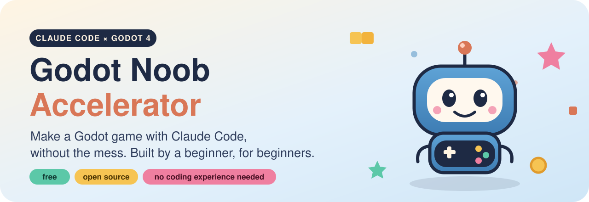
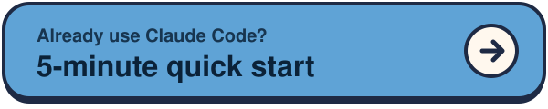
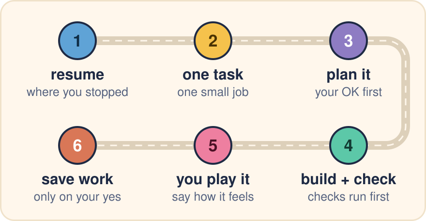
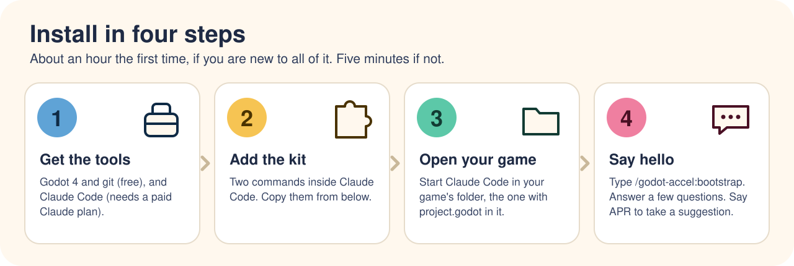

<div align="center">



[](https://github.com/dawnmaster1337/godot-noob-accelerator/releases)
[](https://godotengine.org)
[](https://code.claude.com/docs)
[](LICENSE)

<a href="docs/beginners-guide.md"></a>
<a href="#-install"></a>

</div>

<br>

## 👋 What is it?

An add-on for **Claude Code** that helps it build your **Godot** game carefully: it writes down
what you decide, tests its work before showing you, and remembers where you stopped.

No coding experience needed. It's for a game you'll keep working on for weeks. For a game jam or
a weekend try, plain Claude Code is enough.

## 💥 Why?

Claude Code can make a game. On its own, it also forgets things, guesses, and makes a mess. This
is what went wrong for us:


## 🙋 The honest bit

**We're beginners too.** This is one noob's way of keeping Claude Code careful, shared in case it
helps you. It works for our own games. It might not work for yours, and it might be overkill. If
it sucks, [tell us](#-tell-us-how-it-went).

- 🐢 It's slower than "just build it": Claude asks questions and tests first.
- 📦 It adds about 12 files you'll see (notes, a check script, a smoke test) and about 20 hidden
  ones (Claude's rules, git checks). More appear only when your game needs them.
- 🐧 Only tested on Linux so far.
- 💸 The kit is free. Claude Code needs a paid Claude plan.

## 🔁 How it goes



| You say | Claude… |
|---|---|
| **resume** | picks up where you stopped |
| **I want to add…** | asks a few questions, then makes a plan |
| **let me play it** | tells you what to open and what to try |
| **feels too slow** *(any feeling)* | tweaks a setting, not the code |
| **save work** | saves, but only when you say yes |

Claude gives a suggestion with every question. To take it, just say **APR**, short for
**"as per recommendation"**. Not sure what Claude means? Say **"explain like I'm new"**.

## 🚀 Install



**First time?** Follow the **[beginner's guide](docs/beginners-guide.md)**. It takes about an
hour, from nothing installed to a character moving on screen.

**Already set up?** Start Claude Code **in your game's folder** (the one with `project.godot`),
then run these one at a time:

```
/plugin marketplace add dawnmaster1337/godot-noob-accelerator
```

```
/plugin install godot-accel@godot-accel
```

When it asks where, pick **this repository (project scope)**: the kit then loads only in this
game, not in every project. Restart Claude Code in the same folder, then type:

```
/godot-accel:bootstrap
```

> 🧹 **Already started a game with its own notes?** Type `/godot-accel:realign` instead. It tidies
> them into the kit's places and keeps everything.

## 💬 Tell us how it went

Especially if you got stuck. That's the most useful thing we can hear.
[Open an issue](https://github.com/dawnmaster1337/godot-noob-accelerator/issues/new/choose), even
if it's just "I gave up at step 2".

<details>
<summary><b>More: updating, what's inside, companions</b></summary>

- **Updating:** run `/plugin marketplace update godot-accel`, then `/plugin` → godot-accel →
  update, and start a new session. Then say **update the kit** in your project. Still the old
  version? Run the marketplace update again: it can reuse a stale copy. To update on its own,
  turn on auto-update for this marketplace in `/plugin` → Marketplaces (it's off for kits like
  this one).
- **Trying a test branch:** in `~/.claude/settings.json` (and the project's
  `.claude/settings.json`, if it lists the kit), add `"ref": "<branch>"` to the `godot-accel`
  entry's `source` under `extraKnownMarketplaces`. Then run
  `claude plugin marketplace add 'dawnmaster1337/godot-noob-accelerator#<branch>'` and
  `claude plugin update godot-accel@godot-accel`. Remove the `ref` to go back. Don't run
  `marketplace remove`: it uninstalls the kit and rewrites the project's settings.
- **What's inside, and why:** [how it works](docs/how-it-works.md) ·
  [every file it adds](docs/structure.md) · [making it your own](docs/customising.md)
- **Recommended companion:** [GodotPrompter](https://github.com/jame581/GodotPrompter) knows
  how to build Godot things (movement, menus, saving). This kit is about working carefully.
- **Find or build, your call:** `godot-sourcing` comes with the kit (installing godot-accel
  installs it). Before Claude makes a shader, model, texture, sky or addon, it asks whether to
  find a ready-made one or build it. Choose find, and it shows you a short list of free,
  licence-checked options and records the credit of the one you pick. Kit installed before 0.6.0? `/plugin install godot-sourcing@godot-accel`. More
  companions, shader skills included: [companions](docs/companions.md).
- **Your project learned something?** `/godot-accel:harvest-learnings` writes feedback for this
  kit with your game's details removed. [Contributing](CONTRIBUTING.md) ·
  [changelog](CHANGELOG.md)

</details>

<sub>📜 [MIT licence](LICENSE). Pip the robot and the artwork in `assets/` are part of this repo,
under the same licence.</sub>
