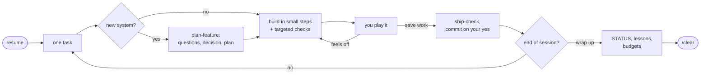

<div align="center">

# Godot Noob Accelerator

**A way of working for making a Godot 4 game with Claude Code.**

You describe the game. Claude builds it, checks its own work, and keeps the project's memory,
decisions and plans in order across every session and machine.

[](https://github.com/dawnmaster1337/godot-noob-accelerator/releases)
[](https://godotengine.org)
[](https://code.claude.com/docs)
[](LICENSE)

[Quick start](#quick-start) · [Beginner's guide](docs/beginners-guide.md) ·
[How it works](docs/how-it-works.md) · [Every file it creates](docs/structure.md) ·
[Customising](docs/customising.md)

</div>

---

## In plain words

**Godot** is a free program for making games. **Claude Code** is Claude working inside a folder
on your computer, where it can write and run code. **This kit** is an add-on for Claude Code
that makes it work on your game the way a careful developer would: it writes down what you
decide, checks its own work before showing you, asks before saving anything, and picks up where
you left off next time.

You don't need to know how to code, or how GitHub works, to use it. This page is just where the
kit lives.

| If you are… | Start here | Time |
|---|---|---|
| New to all of this | **[The beginner's guide](docs/beginners-guide.md)**: every step, from nothing installed to a character moving on screen | about an hour |
| Already using Claude Code | **[Quick start](#quick-start)**, below | 5 minutes |

## Why this exists

Claude Code can write a Godot game. Left to itself, though, it forgets what you decided last
week, claims things work without running them, rebuilds what another machine already pushed, and
lets the notes it reads every session grow until each one costs more than the work.

This kit is the process that stops that. It came out of a real game built over about 100 Claude
Code sessions by someone new to coding, and has since been tuned by other projects using it.
**Every rule in it exists because something went wrong without it**, and each one says what.

It is the *process* layer, not engine knowledge. For how to build a jump, a menu or a save
system, it hands over to [GodotPrompter](#companions).

## Quick start

You need Godot 4 (callable as `godot` from a terminal), git, and Claude Code. Inside Claude Code:

```
/plugin marketplace add dawnmaster1337/godot-noob-accelerator
/plugin install godot-accel@godot-accel
```

Restart Claude Code (`/exit`, then `claude`), then in your Godot project's folder (the one with
`project.godot` in it):

```
/godot-accel:bootstrap
```

Answer up to eight questions (type **APR**, "as per recommendation", to take Claude's
suggestion), say yes to the file list, and you're set. Bootstrap never overwrites a file you
already have.

**A project that already has its own docs** (a status file, a to-do list, a build log, design
notes, its own rules)? Type `/godot-accel:realign` instead. It moves what those files say into the
kit's homes and formats, one home at a time, counts before and after so nothing is dropped, and
archives the originals. Afterwards the project reads like every other kit project.

**Already set up with an older version?** After updating the plugin, say **update the kit** in
the project. The session-start card reminds you when the project is behind, or off the shape.

<details>
<summary>Optional tools, and updating</summary>

- [gdtoolkit](https://github.com/Scony/godot-gdscript-toolkit) (`pipx install "gdtoolkit==4.*"`)
  formats and lints GDScript after every change.
- `jq` or `python3` lets the hooks read their input.
- Missing tools are skipped and reported, never fatal.

**Updating:** third-party marketplaces don't auto-update by default. Run
`/plugin marketplace update godot-accel`, or turn on auto-update under `/plugin` → Marketplaces.

</details>

## A session, start to finish

```text
you     resume
claude  Fetched: nothing new from your other machine. STATUS says next is roadmap task 0.3
        (M), the double jump. Done when: the player can jump once more in mid-air.
        Inbox: one playtest note, logged as a bug. Start on 0.3?
you     APR
claude  One question first: does the second jump reset if you touch a wall?
        Recommendation: no, so walls stay a separate mechanic.
you     APR
claude  [writes the decision record and a short plan, then builds it in small steps,
        checking each one]
        Checks: all 6 passed. To try: open scenes/level_1.tscn, press F5, jump twice
        over the first gap.
you     feels floaty
claude  Raised fall_gravity in resources/jump_tuning.tres from 900 to 1200 (a tuning value,
        so no code changed). Try again?
you     better. save work
claude  Commit "Add double jump" (3 files)? Safe to /clear: no, until you say yes.
```

*(An illustration. Your own sessions will differ.)*

## What's in the box

The kit has two layers: a **plugin** that updates like any plugin, and **templates** that
bootstrap copies into your project once, which are then yours to edit.

### Skills: things you say

| You say | Skill | What happens |
|---|---|---|
| `/godot-accel:bootstrap` | `bootstrap` | Sets a new project up after a few questions; never overwrites a file |
| `/godot-accel:realign` | `realign` | Moves an existing project's own docs into the kit's homes and formats, keeping every fact; one home per commit |
| "resume" | `resume` | Fetches (asks before pulling), reads where you stopped, finds half-done work, empties the inbox, proposes **one task** for the session |
| "I want to add…" | `plan-feature` | Questions one at a time with recommendations, a decision record, a plan with a **Done =** line, your OK before any code |
| `/godot-accel:ship-check` | `ship-check` | Lint, every check, a play-test, a review at milestones, fixes, then "To try:" and a proposed commit |
| "save work", "wrap up", "running out of usage" | `save-work` | A task, session or quick save; commits only on your yes; always ends with "Safe to /clear: yes/no" |
| "update the kit" (the start-up card says when) | `update` | Brings a project set up with an older kit up to date: adds new files, merges new rules into yours without replacing your wording |
| "trim", "lessons" | `trim-context` | Sends each lesson to its one home; keeps the always-read files under their budgets |
| "audit the project", "is the repo tidy?" | `project-audit` | A read-only health check: files in the wrong place, unused or overgrown code, scattered docs, clashing rules, token cost. A plain-words report, then one question per fix |
| before new dialogue or names | `canon-check` | Checks writing against your story bible, if you keep one |
| `/godot-accel:harvest-learnings` | `harvest-learnings` | Turns your project's lessons into feedback for this kit; posts nothing |

### Agents: reviewers Claude sends off

| Agent | Reviews |
|---|---|
| `adversarial-reviewer` | Your changes, uncommitted or a whole milestone's commit range, looking for bugs a player would hit. Answers SHIP or FIX FIRST, each finding with the steps that trigger it |
| `design-reviewer` | Is it fun? Does it read, reward, teach? Ranked changes in player terms |
| `canon-reviewer` | A batch of new writing against your canon docs |

### Hooks: checks that run on their own

| When | What it does |
|---|---|
| Session start | A status card: unpushed or uncommitted work, your own uncommitted scene edits, the inbox, STATUS's next step and size, whether the project's kit version is behind, whether `godot` is reachable. Started in the wrong folder? It says where the project is |
| Before any edit or shell write | Blocks writes to Godot's cache, `*.import`, `*.uid`, `.env` and anything in `.claude/protected-paths.txt` |
| After any `.gd` change | `gdformat`, then `gdlint`; a lint failure goes straight back to Claude |

If your project already registers its own hook script with the same name, the kit's copy stands
down instead of running twice.

### Templates: written into your project

`CLAUDE.md` and `AGENTS.md`; rules for code, scenes, tuning values, docs, git and working with
you; project memory; `docs/` (STATUS, decisions, plans and roadmap, system pages, a bug log,
guides); an `inbox/` drop box; `tools/dev.sh` (checks, lint, dead paths, budgets); an example
headless check; git hooks; optional canon docs, standards page, asset manifest, paid-tools spend
gate and playtester agent. Every file and why: [docs/structure.md](docs/structure.md).

## How it works



The habits behind it:

- **One home per fact.** Where you are lives in STATUS, why in a decision record, what's true now
  in a system page. Everything else points there, so nothing drifts into four versions.
- **Nothing reaches you unchecked.** Checks run and are quoted before you see anything; a new
  check is proven by watching it fail; work is shown neutrally, never praised.
- **You decide, one question at a time.** Each with a recommendation; "APR" takes it. Nothing is
  committed, pushed, posted or paid for without your yes.
- **Your hand edits are yours.** Feel values live in data you can tweak in the Inspector; Claude
  builds on your changes and never reverts them.
- **Every session starts cheap.** Always-read files have character budgets that a script checks
  at every save.

The full tour, with the failure behind each habit: [docs/how-it-works.md](docs/how-it-works.md).

## Grows with you

Start with the defaults. As you get more confident:

- **Edit the rules.** Everything bootstrap wrote is yours: rules in `.claude/rules/`, budgets,
  protected paths, a standing reminder shown at every session start.
- **Add steps to a kit skill** without forking it: `.claude/godot-accel/save-work.md` and friends.
- **Write your own skills** for repeated content work (a level, an enemy, a quest).
- **Branch out:** feature folders and an events bus for bigger games, generated reference docs,
  headless simulations against targets.

How: [docs/customising.md](docs/customising.md).

## Companions

| | What | Why |
|---|---|---|
| **Recommended** | [GodotPrompter](https://github.com/jame581/GodotPrompter): `/plugin marketplace add jame581/skillsmith`, then `/plugin install godot-prompter@skillsmith` | Deep Godot 4 engine know-how: movement, UI, saving, testing, code review. This kit uses its skills when they're installed and deliberately doesn't duplicate them |
| Optional | A Godot editor MCP server (search "Godot MCP") | Lets Claude run the game and read its logs. Bootstrap writes a "never work blind" rule and a `playtester` agent for it |

## Good to know

- **Start Claude Code in the project folder**, the one holding `project.godot`. Started a folder
  too high, the kit's rules and checks don't load (the start-up card tells you).
- **Terse-output or compression plugins** can hide the check output this process asks Claude to
  quote. If Claude stops quoting checks, try without them.
- The kit never commits, pushes, posts or spends anything without your yes.

## Questions

<details>
<summary><b>Does it cost anything?</b></summary>

The kit is free. You need a Claude plan that includes Claude Code; Godot, git and GitHub are free.
</details>

<details>
<summary><b>Do I need a GitHub account?</b></summary>

Not to install the kit. You'll want one to back up your game and use it on more than one
computer; the beginner's guide sets it up.
</details>

<details>
<summary><b>Will it mess up a project I already have?</b></summary>

No. Bootstrap never overwrites a file, and a project with its own docs goes to `realign`, which
keeps every fact, shows before/after counts and archives (never deletes) the originals. Nothing is
committed without your yes.
</details>

<details>
<summary><b>I set it up a while ago. How do I get the new features?</b></summary>

Update the plugin (`/plugin marketplace update godot-accel`), then say **update the kit** in your
project. It adds what's new and asks before changing anything you wrote.
</details>

<details>
<summary><b>The project feels messy. What now?</b></summary>

Say **audit the project**. You get a plain-words list of what's out of place or unused, and
Claude asks about each fix one at a time. If the project's docs don't follow the kit's shape at
all (`tools/dev.sh conform` says so), `/godot-accel:realign` fixes that in one pass.
</details>

<details>
<summary><b>I'm stuck.</b></summary>

Tell Claude, in your own words: "I don't understand, explain it like I've never coded." For
setup problems, see the beginner's guide's
[when something goes wrong](docs/beginners-guide.md#when-something-goes-wrong).
</details>

## Feedback and contributing

This kit improves from what real projects run into.

- **Tried it?** Open an issue with the **Feedback** template.
- **Your project learned something?** Run `/godot-accel:harvest-learnings` in it. It writes
  ready-to-paste issue bodies for the **Learning** template, with your game's content stripped
  out, and never posts anything itself.
- **Changes** are welcome: see [CONTRIBUTING.md](CONTRIBUTING.md) and the
  [changelog](CHANGELOG.md).

## Licence

[MIT](LICENSE).
