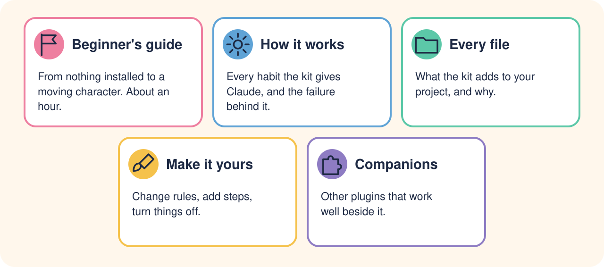
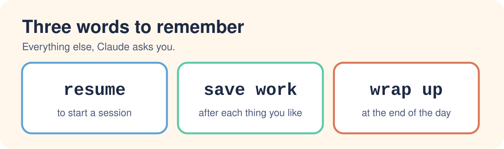
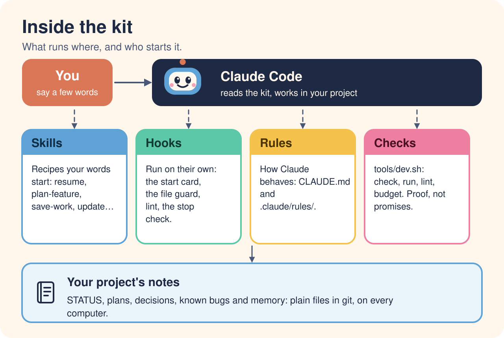

# The guides

| | Guide | Read it when |
|---|---|---|
| 🚩 | [**Beginner's guide**](beginners-guide.md) | You're starting from nothing. About an hour to a character moving on screen |
| ⚙️ | [**How it works**](how-it-works.md) | You want to know what Claude does each session, and why |
| 📁 | [**Every file**](structure.md) | You're wondering what a file in your project is for |
| 🖌️ | [**Make it yours**](customising.md) | A rule doesn't fit how you work, or you want to add your own steps |
| 🧩 | [**Companions**](companions.md) | You'd like Godot know-how, shader help or other plugins beside the kit |

## The short version

Stuck, or something's unclear? That's useful to us:
[open an issue](https://github.com/dawnmaster1337/godot-noob-accelerator/issues/new/choose).
Back to the [project page](../README.md).
