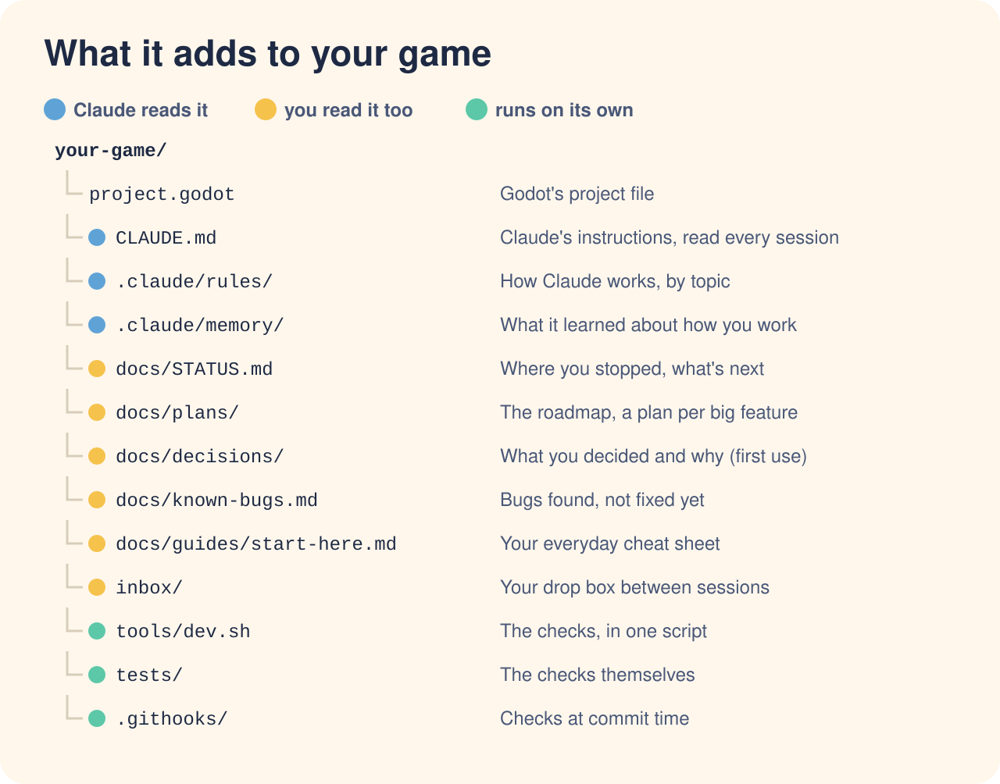

# Structure: every file bootstrap writes, and why

Bootstrap writes the **setup** files: about 12 you'll see and about 20 in hidden folders. The
**first use** files stay in the kit until your game needs them (the first decision, the first
system page, another agent joining); then the step that needs one copies it from the kit's
templates. The shape (`.claude/godot-accel/shape.md`) marks each home setup or first use, and
`tools/dev.sh conform` only asks for a first-use home once it exists.

Bootstrap never overwrites: for a file you already have it shows the difference and asks (keep
yours, append a delimited section, or replace on your word). "Optional" files are written only
when you pick them.

## Project root

| File | Made | Why it exists |
|---|---|---|
| `CLAUDE.md` | setup | Claude's instructions, loaded every session: pitch and pillars, where each kind of fact lives, the **Hard rules**, workflow, commands. Under 200 lines |
| `AGENTS.md` | first use | The read order and per-task loop for any other AI agent or developer |
| `.gitignore`, `.gitattributes` | setup | Appended in a `>>> godot-accel >>>` block: Godot's cache, exports, secrets, local Claude settings, the inbox; LF line endings, LFS lines commented out |
| `project.godot` | setup | One line added for GDScript: `untyped_declaration` set to error, so the typing rule is checked by Godot |

## `.claude/`

| File | Made | Why |
|---|---|---|
| `rules/working-with-user.md` | setup | One question at a time with recommendations, APR, stale question lists, echo requests back, recording answers, paused plans, timeboxed polish, trigger words |
| `rules/handing-over.md` | setup | Stills and clips, one piece then a review, "open X, try Y", steps for the user last, one runner per command, a final message that stands alone |
| `rules/git.md` | setup | Fetch and ask before pulling; commit on yes; stage by path; no blanket destructive commands; secrets never in chat; worktree cleanup |
| `rules/showing-work.md` | setup | Checks before the user sees anything, quoted; UI seen before "works"; break tests that cross the line; driven input and the ruler doubted; show neutrally, never praise |
| `rules/docs.md` (`paths: docs/**` …) | setup | One home per fact, naming, fixing every copy, budgets, one term per thing |
| `rules/scenes.md` (`paths: *.tscn, *.tres, **/project.godot`) | setup | Engine-owned files, moving a script with its `.uid`, third-party plugins, `.tres` diffs, input actions |
| `rules/tuning.md` (`paths: *.tres, *.tscn, tuning scripts`) | setup | Feel values in `Tuning` Resources; change the preset, not only the default; the user's hand edits are theirs |
| `rules/gdscript.md` / `csharp.md` (`paths: *.gd` / `*.cs`) | setup | Language rules, loaded only when Claude touches those files |
| `rules/godot-mcp.md` *(optional)* | setup | "Never work blind" when an editor MCP server is used |
| `rules/paid-tools.md` *(optional)* | setup | Spend gate for any paid API; stop spending when approval fails |
| `memory/MEMORY.md`, `memory/README.md` | setup | The project's memory index (imported by CLAUDE.md, so it loads on every machine with nothing to set) and its format |
| `budgets.md` | setup | Character budgets. A commit is refused only for a file read every session that is over; the rest are a warning |
| `godot-accel/shape.md` | setup | **The project's shape:** each home's path, kind (live, plan, history), headings, entry format, and whether bootstrap makes it or it waits for first use. Add a row for a home of your own |
| `godot-accel/kit-version` | setup | The kit version the project was set up or last updated with; `update` and the session-start card compare it with the plugin |
| `protected-paths.txt` | setup | Extra paths the editing-tool guard blocks (`addons/*` …), with `!` exceptions |
| `settings.json` | setup | The suggested permissions merged in on your yes: **ask** before every commit (and push, unless Claude pushes for you); **deny** reading secrets and any write to Godot's cache, `.import` and `.uid` files, by the editing tools, with a guard-rail for the shell commands Claude Code recognises as file writes; Claude Code's machine-local auto memory off, so `.claude/memory/` is the only one; new worktrees start from your local commits |
| `reminder.md` | first use | Rules you've had to say twice, repeated to Claude with every message you send (under 600 characters) |
| `start-guard.md` | first use | A short standing reminder shown at every session start (setup when standards are picked) |
| `agents/playtester.md` *(optional)* | setup | Drives the game through your editor MCP; never edits |

## `docs/`

| File | Made | Why |
|---|---|---|
| `STATUS.md` | setup | Where work stopped, **Next**, the only open-questions list. Read first on resume; under 5,000 characters; no session logs |
| `known-bugs.md` | setup | Bugs known and not yet fixed (repro, expected, actual), and the last 20 fixed with their cause |
| `plans/roadmap.md` | setup | The milestones and the build log (ticked tasks carry their date) |
| `.gdignore` | setup | Godot skips the folder: notes and screenshots never get imported |
| `guides/start-here.md` | setup | Your one-page daily routine |
| `guides/between-sessions.md` | setup | What you can do while Claude isn't running: inbox drops, note shapes |
| `guides/setup-new-machine.md` | setup | Install, clone, hooks path, the daily routine across machines |
| `guides/quirks.md` | setup | Engine and tool gotchas, one line each, seeded with ones verified on Godot 4.7 |
| `plans/<date>-<topic>.md` | first use | A feature's plan (Done =, design, ticked tasks), from `plan-feature` |
| `decisions/README.md`, `<date>-<topic>.md` | first use | Index of decisions with status, and one record per topic (your answers, rejected options) |
| `systems/<system>.md` | first use | "What is true now" page per system, with its checks, sources and doc-vs-code mismatches |
| `research/README.md` | first use | What good looks like (notes on reference works) and what the project already holds; named in every plan and subagent brief once it exists |
| `reviews/`, `archive/` | first use | Where audit reports, finished plans and retired docs go |
| `canon/` *(optional)* | setup | `bible.md`, `README.md` (who owns it), `requests/_template.md` |
| `standards.md` *(optional)* | setup | Row-by-row standards with status (locked, proved, proposed, open, later) |
| `production/manifest.md` *(optional)* | setup | Every asset the game needs and where it stands |

## Other folders

| File | Made | Why |
|---|---|---|
| `inbox/README.md`, `inbox/.gdignore` | setup | The drop box; Godot ignores it, git tracks only the README |
| `tools/dev.sh` | setup | `check` (refresh when files changed, then every or the named headless checks, GUT or gdUnit4 too; fails when nothing ran), `refresh`, `lint`, `stale`, `conform`, `budget`, `tidy` |
| `tests/smoke_check.gd`, `.tscn` | setup | Loads every script, scene, resource and shader, then plays the main scene for a second; any error Godot prints fails it (a missing node, a failed load, a shader that doesn't compile, `push_error`), named by file. The pattern each system's own check copies; an error a check expects on purpose goes in `tests/expected_errors.txt` |
| `.githooks/` | setup | Do nothing until `git config core.hooksPath .githooks` (per clone). `pre-commit`: lint, format, no `.godot/`, `.env` or key-shaped strings, budgets. `pre-push`: hands over to git-lfs. The identity checks are the maintainer's own tool and run only where `~/.config/identity-guard/` exists (`.githooks/README.md`) |

## In the plugin (not copied; updated with the plugin)

Skills (`resume`, `plan-feature`, `ship-check`, `save-work`, `trim-context`, `project-audit`,
`canon-check`, `harvest-learnings`, `bootstrap`, `realign`, `update`), agents (`adversarial-reviewer`,
`design-reviewer`, `canon-reviewer`) and hooks (session start, a per-message reminder of rules you
had to repeat, a path guard for the editing tools, format + lint, and a stop check that asks for
the headless checks after game files changed). Project-specific steps for a kit skill go in
`.claude/godot-accel/<skill>.md` (`docs/customising.md`).
